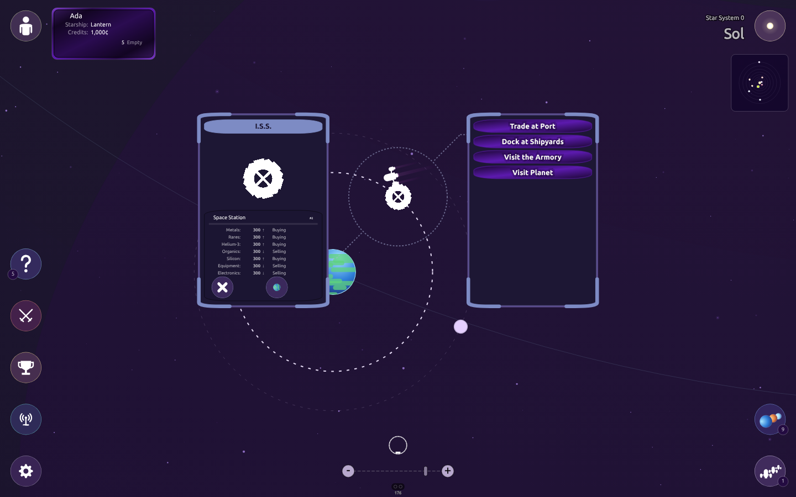
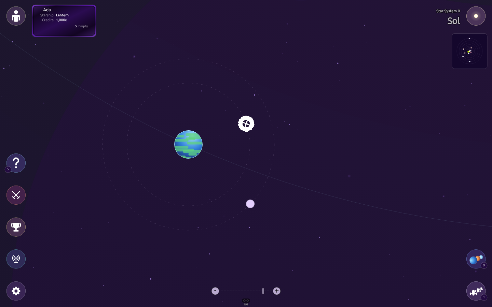
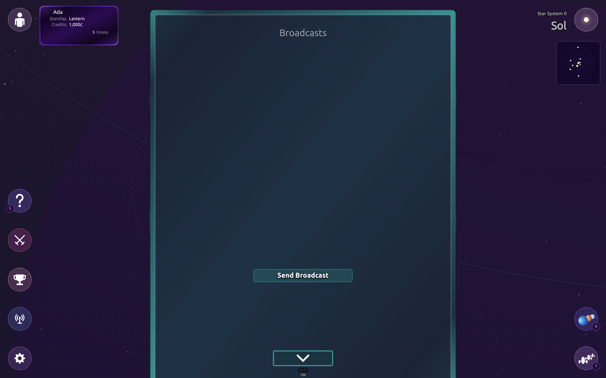
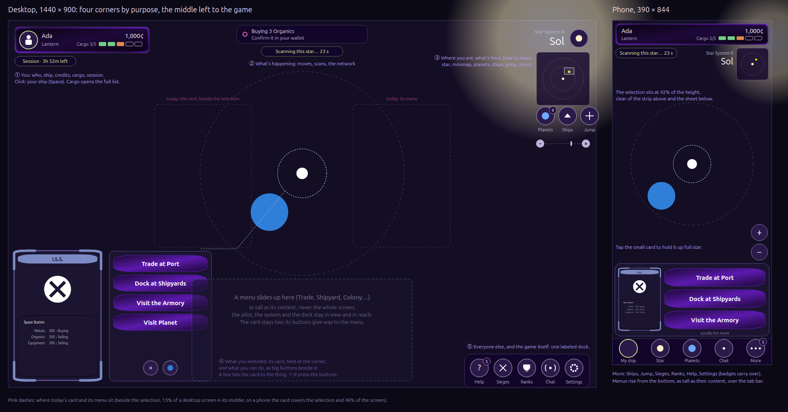

# Orbiter 8's HUD: analysis and redesign

For Koda. This is the experimental second client in `client-rnd/hud/`: the main client's star system,
art, stores and SDK wiring, with the HUD layer redesigned. `orbiter-client/` is untouched.

- Part 1: what the current HUD does (the inventory: nothing may be lost).
- Part 2: what's wrong with it, with screenshots.
- Part 3: principles from good game HUDs, each tied to a decision here.
- Part 4: the proposed layout, desktop and phone. Mockup: [`mockups/hud-layout.svg`](mockups/hud-layout.svg)
  ([PNG](mockups/hud-layout.png)).
- Part 5: where every function lives now.
- Part 6: what was kept on purpose, and what's for you to decide.

Screenshots of the current HUD are in `mockups/before/` (`d-` desktop 1440×900, `p-` phone 390×844),
taken from an unchanged copy of the main client on 2026-11-14. Screenshots of the new one are in
`mockups/after/`.

## 1. Inventory: everything the current HUD does

Read from `orbiter-client/src/components/` (`star-map/hud/`, `playgame.vue`, `star-map/map.vue`,
`galaxy-map.vue`, `transaction-tray.vue`, `game-dialog.vue`, `gamepad-overlay.vue`) and played.

### Always on screen (the rim)

| # | Function | Today |
|---|---|---|
| R1 | My ship: select it and fly the camera to it | round "person" button, top left; Space; gamepad Start |
| R2 | Pilot card: call sign, ship name, credits, each good aboard, empty holds | panel beside R1 (under it on phones; past five goods, "+N more") |
| R3 | Session key's time left | small yellow text under the pilot card |
| R4 | Star system: number and name | text, top right |
| R5 | Star button: select the star; pressed again, zoom out to the galaxy map | round button, top right, in the star's color |
| R6 | Minimap: orbits, planets, stations, ships (yours yellow), the camera's box; click to look there | top right |
| R7 | Scan countdown ("Scanning this star… 23 s", "Recording the scan…") | small yellow text under the minimap |
| R8 | Help / first steps, with a badge of steps left | round button, left edge |
| R9 | Siege feed, ringed pink while one of your planets is besieged | round button, left edge |
| R10 | Leaderboard | round button, left edge |
| R11 | Chat (broadcasts), with a count badge | round button, left edge |
| R12 | Settings | round button, bottom left |
| R13 | Planets list, with a count badge | round button, right edge |
| R14 | Ships in this system, with a count badge | round button, bottom right |
| R15 | Zoom: −, +, and a marker showing the zoom level | bottom center |
| R16 | Show or hide the selection's card | dashed ring button above the zoom |
| R17 | Connection status: two loading lamps and the block number | tiny, bottom center |
| R18 | Loading bar before the map has loaded | center |
| R19 | Interface size (0.75×–1.5×, from Settings) scales the rim | |

### The selection (what pops up when you select something)

| # | Function | Today |
|---|---|---|
| S1 | The selection card, an NFT playing card: name in its title pill, the art, type, id, "Mine", and stats by type (ship: captain, holds, cargo, orbiting; planet: owner, class, size, rings, orbit; station: its port's goods, amounts and buying/selling; moon; star) | left of the selection (the whole screen's width on phones) |
| S2 | The card's colors: frame brackets and title in the selection's color; a yellow star badge if it's yours; a pink dashed frame under siege | |
| S3 | The action card: one big button per action (below) | right of the selection; on phones behind the card's hamburger button |
| S4 | Card shortcuts: close (×); to the planet's station; to its moons (with a count); to a station's or moon's planet; phones: flip between card and actions | round buttons on the card's bottom edge |
| S5 | Moons list: one button per moon | replaces the action card |
| S6 | Dashed ring around the selection, dashed leaders to both cards | |
| S7 | The camera follows the selection; the ship flies to it | |

Actions offered (from `card-menu.js`): **star**: Jump To Neighbor Star, Go Through the Black Hole,
Name / Rename Star. **Planet**: Recruit Colonists (Earth), Claim Planet (fee; dimmed if you can't pay),
Colony (yours), Attack (dimmed unless armed), Siege Status, Visit Space Station, Visit Moon, View on
(market). **Ship**: Jump To Neighbor Star, Ship Loadout, Start / End Session, View on (market).
**Station**: Trade at Port, Dock at Shipyards, Visit the Armory, Visit Planet. **Moon**: Visit Planet.
**Anything of yours**: Rename.

### Menus that slide up

| # | Menu | What it does |
|---|---|---|
| M1 | Trade | the port's goods and prices (three-letter codes on the card), your cargo and balance, a slider per good on Buy and Sell, the trade's total, Make Trade |
| M2 | Shipyard | buy holds (a dial for how many, the price), Upgrade Engines |
| M3 | Armory | parts list with prices, a count, Buy and Fit |
| M4 | Colony | People, Storage, Buildings and Factory pages: land and take colonists, deliver and collect goods, build the line (Citadel → Armory), order parts, install them, send them to the ship or the moons; Tech Tree |
| M5 | Siege | both sides' strength, rounds, the actions the contract allows now |
| M6 | Loadout | the ship drawn with what's fitted; Unload |
| M7 | Planets | every planet here as a row (art, name, owner, class, port code); click to select |
| M8 | Ships | every ship here; click to select |
| M9 | Chat | the last 12 broadcasts, Send Broadcast |
| M10 | Leaderboard | pilots ranked by credits or planets, Refresh |
| M11 | Feed | the public siege feed, live ones in pink |
| M12 | Help | the five first steps, ticked as done; How Planets Grow (the tech tree) |
| M13 | Settings | graphics level, interface size, music and effects volume, Back to Title |
| M14 | Close a menu | the chevron button at the bottom, clicking outside it, Esc, gamepad B |

### Over the game

| # | Function | Today |
|---|---|---|
| O1 | Galaxy map: the hex map, hover/tap lines, the chosen star's card (Jump, Enter the black hole, Cancel), "Back to …", "My ship", a hint line, the scan in words | replaces the whole HUD |
| O2 | Transaction tray: waiting for the wallet, sent, done, failed (why, dismiss), lost contact, back in contact | top center |
| O3 | Dialogs: confirm, name, number (claim, rename, recruit, session, attack, broadcast) | center |
| O4 | Jump animation, with a stall message and a way back when a jump fails | whole screen |
| O5 | Black-hole entry animation | whole screen |
| O6 | Tech tree reference | whole screen |
| O7 | Minerva panel (backtick): profile, terminal, sprites, debug | top right |
| O8 | Gamepad overlay: D-pad focus ring, right-stick cursor, A to click | |

### Controls

| # | Input | Does |
|---|---|---|
| C1 | Click a body / empty space / drag / wheel / pinch | select / deselect and close menus / pan / zoom / zoom |
| C2 | Esc | back one level: galaxy map, then menu, then selection |
| C3 | Space; Tab, Shift+Tab, `[`, `]` | my ship; next / previous planet |
| C4 | Arrows; `=` `-` `+` `_` | pan; zoom |
| C5 | `` ` ``; `~`; `S` | Minerva; graphics level; SVG screenshot |
| C6 | Gamepad: B back, Y planets, X jump, L1/R1 planets, Start my ship, Select settings, R3 card on/off, triggers zoom, left stick pan, D-pad focus, right stick cursor, A click | |

## 2. What's wrong, and why

### 2.1 Selecting something covers the middle of the view (your first issue)

- **Desktop:** two 238 × 350 px cards sit left and right of the selection, with a dashed ring and
  leaders between them. Together they take 13% of a 1440 × 900 screen, and it's the 13% in the middle,
  where the system is. In the shot above the card covers a third of Earth; the planet the station orbits is
  the first thing you'd want to see. The action card is mostly empty (four buttons in a card sized for
  twelve), so most of what it hides, it hides for nothing.
- **Phone:** the card is 320 × 470 px, 46% of the screen, drawn *on top of the selection itself* and over
  three of the left-edge buttons (`before/p-01-ship.png`). The actions are behind a hamburger button on the
  card: selecting a station shows no "Trade" until a second tap, and then the action card hides the
  information card (`before/p-03b-station-menu.png`). In a game where "the buttons are the game", the
  buttons are one tap further away than the stats.
- **Why it happened:** the cards are anchored to the selected sprite, which the camera centers. Anything
  anchored to the center covers the center. The art isn't the problem; the anchor is.
- **The camera makes it worse:** the selection is always followed, so the cards can never be dragged out
  of the way; and the only way to see behind them is to hide them (the dashed ring button, R16), which
  hides the actions too.

### 2.2 The rim buttons are poorly arranged (your second issue)

- **Grouped by when they were added, not by what they're for.** Left edge, top to bottom: me, help,
  sieges, leaderboard, chat, settings. Right edge: star, minimap, planets, ships. "What's in this system"
  is split between the top right (star, minimap) and the bottom right (planets, ships), with 500 px of
  nothing between them; "other people" (chat, leaderboard, sieges) is mixed with "the game" (help,
  settings).
- **No labels.** Ten round icon buttons; several icons aren't self-explanatory (the broadcast tower is
  chat, the crossed blades are a feed, the two planets are a list, the star button turns into a jump
  button after one click). The only label is a hover tooltip, which a phone and a gamepad never show.
- **The most-used control is the smallest.** Jumping is the core loop; it's reached by clicking the star
  button *twice* (it changes meaning in between), or through the ship's or star's card.
- **Badges are ambiguous:** "9" on planets and "1" on ships are counts of things; "5" on help is tasks
  left; chat's is messages in the window, not unread ones. Same badge, three meanings.
- **On a phone** (`before/p-14-nothing.png`) the left column's five buttons run up the left edge from the
  bottom, the upper ones outside a thumb's easy reach, and the open card covers three of them.
- **Status text is scattered and tiny:** the session's time is 9 px text under the pilot card; the scan's
  countdown is 9 px text under the minimap, at the far corner from the session. Both are things the player
  waits on.

### 2.3 Menus take the whole screen and hide the HUD

- Every menu is a panel the full height of the screen, whatever is in it. Chat with no messages, Settings
  with four controls and Planets with three rows all cover the same 725 × 900 px.
- Opening any menu but chat removes the whole rim (`v-if="!isMenuOn"`): no credits while you shop in the
  armory (trade draws its own balance; the others don't), no way to go from one menu to another without
  closing first, no scan countdown while you trade.
- The only visible way out is the chevron at the very bottom; on desktop that's the far end of the screen
  from wherever the pointer was.
- On phones the menus are designed for the full height, and that's fine: a phone menu is a full sheet.
  The fixed height is a desktop problem.

### 2.4 Smaller things

- **The pilot card's cargo list grows downward** (two columns of text). With eight goods it is tall, and on
  phones it's cut to "+N more". A capacity bar reads faster than a list of numbers (see P4).
- **The zoom control's − and + are 20 px targets**, under the 44 px a finger needs, and sit in the bottom
  center where a phone's home gesture is.
- **R16 (hide the card)** exists only because the cards are in the way. Once they aren't, it isn't needed
  as a rim button.
- **The galaxy map drops the whole HUD,** including credits. Its star card sits in a different place
  (bottom center, over the map) from the system's cards.
- **Keyboard:** only my ship and planets have keys. Menus have none; card actions have none.
- **Found while playing, not HUD layout:** the galaxy map warns `Property "startShift" was accessed during
  render but is not defined` on every render (in the main client too: `galaxy-map.vue`).

## 3. Principles, and what each decides here

From HUDs that are well regarded (StarCraft II, Homeworld, Stellaris, FTL, Dead Space, Hearthstone,
Slay the Spire, Into the Breach) and from the writing on them (Fagerholt and Lorentzon's *Beyond the
HUD* on diegetic interfaces; Desurvire and Wiberg's playability heuristics; Nielsen's ten; Fitts's law;
Apple's and Google's touch guidance; Hoober's thumb-zone studies; the Game Accessibility Guidelines and
console safe-area notes). Each is weighed against Orbiter 8's own identity: menu-driven, cards, big
buttons, a quiet purple panel over a loud universe.

| # | Principle | In short | Decision here |
|---|---|---|---|
| P1 | **Protect the play area** | The thing the player is looking at is never under the interface. RTS and 4X games put panels on edges and corners; the center belongs to the world. | Nothing in the HUD is anchored to the selection. The card and its buttons sit at the bottom left; the selection keeps its dashed ring, and a dashed leader ties it to the card. The camera's focus point (42% down the screen) is clear of every panel on both layouts. |
| P2 | **Group by purpose (proximity)** | Things used together sit together; a region means one thing, so the eye learns where to look. StarCraft: selection bottom center, commands bottom right, map bottom left, and it never changes. | Four regions: **you** (top left), **where you are** (top right: star, minimap, planets, ships, jump, zoom), **what you selected** (bottom left), **everyone else and the game** (bottom right dock: help, sieges, ranks, chat, settings). Notices come in at top center. |
| P3 | **Information hierarchy** | Size and position follow importance and frequency. | The selection's buttons are the biggest controls on screen (the buttons are the game). Credits are the largest number in the pilot plate. Jump gets its own labeled button. Block number and loading lamps stay tiny. |
| P4 | **Glanceability** | A state should be readable in a fraction of a second: shape and fill before digits. | Cargo is a row of holds, filled in each good's color (the color guide's goods colors, with the count beside it); the full list is one click away. Session and scan are chips with the same shape, in "yours" yellow. |
| P5 | **Progressive disclosure** | Show the common, reveal the rest on demand. | Cargo: bar, then list. Phone: five tabs, then More. Phone card: small, then held up full size. Menus only as tall as their content. |
| P6 | **Diegetic where it's cheap** | Interface that belongs to the world (Dead Space's spine, the card in Hearthstone's hand) reads faster and feels less like chrome. | The selection card is *held at the corner like a card in your hand*, not turned into an inspector panel: it stays the NFT playing card, art first. The selection ring and leader live in the world's space. |
| P7 | **Fitts's law** | Big and close beats small and far; screen edges and corners are the easiest targets. | Action buttons are 40 px tall and 230 wide (44 on phones), next to the card. Regions sit in corners. Zoom buttons grow from 20 to 30 px (40 on phones). A menu's close button is at its top right corner on desktop, where the eye lands, and at the bottom on phones, where the thumb is. |
| P8 | **Consistency** | The same thing in the same place, looking the same, every time. | One badge style. The galaxy map's star card moves to the selection's corner. Every menu opens in the same sheet with the same close. |
| P9 | **Recognition over recall** | Labels beat memory. | Every rim button has a word under it. Tooltips name the key. Number keys press the card's buttons, and each button shows its number (hidden on touch screens). |
| P10 | **Visibility of system status** | The game always says what it's doing. | The tray, the scan chip and the session chip stay up while menus are open (on desktop). The dock shows which menu is open. |
| P11 | **Don't hide the HUD to show a menu** | Context stays. | The pilot plate (credits, cargo), the system block and the dock stay while a menu is open on desktop. Any dock button swaps the menu directly. |
| P12 | **Thumb zones** | On a portrait phone the bottom third is easy, the top is a stretch. Actions go low, status goes high. | Phone: status at the top (pilot strip, system, chips); the selection's buttons and the tab bar in the bottom third; zoom on the right edge at thumb height. |
| P13 | **Safe areas** | Keep clear of notches, home indicators and a host app's bars. | The HUD's edges use `env(safe-area-inset-*)` plus a margin, so it sits inside whatever the Polkadot App puts around a Product. |
| P14 | **Touch targets ≥ 44 px** | | Tabs, action buttons, the phone's zoom, the card shortcuts. |
| P15 | **Controller and keyboard parity** | Everything reachable without a pointer, focus always visible. | The HUD is real `<button>`s now, so Tab, Enter and the focus ring work for free, and the gamepad's D-pad (which walks `button` elements by position) reaches every control. New keys: `M` galaxy map, `P` planets, `H` help, `C` chat, `L` leaderboard, `F` feed, `1`–`9` the card's buttons. All old keys and pad buttons kept. |
| P16 | **Cheap to draw** | An interface shouldn't cost frames. | The rim is HTML, outside the game's SVG, so the world's repaints and the HUD's don't touch each other. No filters, no backdrop blur; panels are flat fills and CSS gradients. The card is the only per-frame SVG (its art turns), as before. |
| P17 | **Color carries meaning** (the color guide) | | Unchanged: yellow for yours and good for you (your button, session, scan), pink only where the player is needed (the besieged ring, failures). Buttons purple. Tints on the dock as Koda approved (H2). |

**Against "industry best practice" where it would make the game generic.** You rejected a docked
inspector and side panels before. This design moves the card to a corner, which is close to that line, so
to be plain about the difference: the card is still the card (same art, same proportions, same title pill,
brackets, badge and pink siege frame), the actions are still big purple pills, and nothing is a list of
properties in a sidebar. What changed is where the card is held.

## 4. The proposed layout

Mockup: [`mockups/hud-layout.svg`](mockups/hud-layout.svg).

### Desktop (wider than tall)

| Region | Holds |
|---|---|
| Top left: **you** | The pilot plate (Koda's purple-striped frame): the my-ship button, call sign, ship, credits, the cargo bar. Under it, the session and scan chips. Clicking the cargo bar opens the full cargo list. |
| Top center: **notices** | The transaction tray. |
| Top right: **where you are** | System number and name, the star button, the minimap; under it Planets, Ships and Jump (labeled, with counts), and the zoom control. |
| Bottom left: **the selection** | The card, and beside it a panel of the same height with its buttons. Card shortcuts (close, station, moons, planet) under the buttons. A dashed ring on the selection and a dashed leader to the card. |
| Bottom right: **the dock** | Help, Sieges, Ranks, Chat, Settings: labeled, tinted as today, badges on help and chat, the pink ring on sieges. |
| Bottom center | Menus slide up here, as tall as their content. Tiny connection lamps and block number stay at the very bottom. |

With a menu open: the plate, the system block and the dock stay. The card stays (you still see who
you're trading with); its buttons hide, because the menu is what you're doing now.

### Phone (portrait)

| Region | Holds |
|---|---|
| Top | The pilot strip, full width: call sign, ship, credits, cargo bar (tap for the list). Under it: system name and minimap on the right; session and scan chips on the left. |
| Right edge, thumb height | Zoom + and −. |
| Above the tab bar | The selection sheet: the card small on the left (tap to hold it up full size; tap again to put it down), its buttons on the right at 44 px, scrolling past three; shortcuts in a row under the card. |
| Bottom | The tab bar: My ship, Star, Planets, Chat, More. More holds Ships, Jump, Sieges, Ranks, Help and Settings; badges and the siege ring carry onto More. |

Menus rise as a sheet from the bottom over the tab bar, with the close chevron at the bottom. They're
as tall as their content, up to the whole screen.

### The galaxy map

The pilot plate stays. The hint line stays at top center. The chosen star's card moves to the
selection's corner (bottom left; a bottom sheet on phones), so "what I chose" and "what I can do" are
where they are in a system. "Back to …" and "My ship" sit at the bottom right, where the dock is.

## 5. Where everything lives now

The map from Part 1's inventory to the new HUD (`src/components/hud/`).

| # | Function | Now |
|---|---|---|
| R1 | My ship | The round button in the pilot plate (desktop); the first tab (phone). Space, pad Start. |
| R2 | Pilot card | The pilot plate / strip: call sign, ship, credits, and under them every cargo hold drawn, one cell each in its good's color (round 2); click it for every good, parts and repairs, and empty holds. |
| R3 | Session time | Yellow chip under the plate. |
| R4 | System number and name | Top right, as before. |
| R5 | Star button | Top right beside the name (desktop); the Star tab (phone). Its second press still opens the galaxy map; **Jump** is now also its own button. |
| R6 | Minimap | Top right, under the name, with the zoom rail beside it. Click to look there, drag to pan, scroll to zoom (round 2). |
| R7 | Scan countdown | Yellow chip under the plate, with the session's. |
| R8–R12 | Help, Sieges, Leaderboard, Chat, Settings | The dock, bottom right (desktop). Phone: Chat is a tab; the rest are under More. |
| R13, R14 | Planets, Ships | Under the minimap (desktop). Phone: Planets is a tab, Ships is under More. The system's star and planets are also on the strip over the selection card (round 2). |
| R15 | Zoom | The zoom rail beside the minimap, as tall as it, on desktop and phone (round 2): +, −, a draggable thumb, marks for your ship, the whole system and the galaxy map; click the rail or a mark, scroll over it or the minimap; a keyboard slider. `=` `-` `+` `_` and pad triggers as before. |
| R16 | Hide the card | The × in the card's menu puts it away; a pill with the selection's name brings it back. Pad R3. Separately, the menu itself slides in behind the card and out (its tab, or A): see S3. |
| R17, R18 | Connection lamps, loading bar | Unchanged (bottom center; center). |
| R19 | Interface size | Scales the whole HUD (Settings). |
| S1, S2 | The card and its colors | Bottom left, unchanged art. Phone: small in the sheet; tap to hold it up. |
| S3 | Actions | The menu behind the card (round 2): it slides out from behind the card and back by the tab on its edge (or A); in, its edge and tab still show. A little smaller than the card. Every action has its own slot by kind of selection (`card-actions.js` SLOTS), empty slots kept as faint sockets, so a button never moves; keys 1–9 are the slots. With a menu open it slides in on desktop. |
| S4 | Shortcuts | The menu's icons, each in a fixed place: its planet, its station, its moons (one moon: straight to it), then put the card away. The duplicate "Visit Space Station / Moon / Planet" buttons are gone (round 2). |
| S5 | Moons list | The moons icon (with more than one moon) lists them in the menu, with Back. |
| S6 | Ring and leaders | A ring on the selection and one leader to the card. |
| S8 | Next / previous body (new, round 2) | The system strip over the card: the star and every planet in orbit order, the selection ringed, ‹ › to step (as Tab, `[` `]`, pad L1/R1). With nothing selected it stays at the bottom left. |
| S7 | Camera follows | Unchanged. |
| M1 | Trade | Rebuilt in HTML (round 2, `hud/trade/`): one row per good (code, icon and color; what the port does and at what price; the two-way slider, port left and ship right; aboard before and after; the line's credits), under the port-and-ship drawing with every hold drawn; the port's letters, readouts and Make Trade kept. |
| M2 | Shipyard | As before, its drawing showing every hold, the ones being bought in yellow; the engines' picture by Upgrade Engines (round 2). |
| M3–M5, M11 | Armory, colony, siege, feed | As before, each with a picture of what's happening (round 2, `widgets/menu-scene.svg.vue`): the port fitting parts to your ship; per colony page colonists, storage, the next building, the Autofactory, defenses; the attacker and the planet trading fire; the siege art over the feed. |
| M6–M13 | The other menus | The same menus, in a sheet as tall as their content; the rim stays (desktop). |
| M14 | Close | × at the sheet's top right (desktop), chevron at the bottom (phone), click outside, Esc, pad B, or press the dock button again. |
| O1 | Galaxy map | As above; each visited star shows its ports' count (a small station and the number), in its tooltip and in the chosen star's card (round 2, `libs/port-counts.js`). |
| O2 | Tray | Top center, under the pilot strip on phones. |
| O4 | Jump animation | Reworked (round 2, `libs/jump-slide.js`): the backdrop stays; the system (or the galaxy map, if you jumped from it) slides off to the left as the streaks and the ship slide in from the left; the cruise as before (at least Minerva's 4.5 s); on arrival the ship flies off to the right, the streaks follow, and the new system slides in from the right (Koda, after round 2) at the zoom you left at, then the camera flies to your ship. The stall and its Return button kept. |
| O3, O5–O8 | Dialogs, black hole, tech tree, Minerva, gamepad overlay | Unchanged (the black hole's jump plays the new slides). |
| C1–C6 | Controls | All kept; new: `M`, `P`, `H`, `C`, `L`, `F`, `1`–`9`; round 2: `A` slides the selection's menu, arrow keys on a focused slider (zoom, trade). |

## 6. Kept on purpose, and for you to decide

**Kept:** the card's art; the pill buttons and their purple; the pilot card's striped frame; the round
tinted buttons and their icons; every menu's inside (trade's sliders and port codes, the shipyard, the
colony's pages…); the tray; dialogs; colors and their meanings; "menus slide up in the middle".

**For you to decide:**

1. **The card at the corner.** It's the heart of this redesign and the nearest thing to the "docked
   inspector" you turned down. If it reads as generic to you, the fallback that still clears the view is
   to keep the card anchored but put card and actions *on one side* of the selection and move the
   camera's focus off-center.
2. **Labels under the rim buttons.** They cost a little space and make the rim less minimal. They could
   show only until the first steps are done.
3. **The cargo bar** in place of the cargo list on the pilot card (the list is one click away).
4. **Which five things are a phone's tabs.** I chose My ship, Star, Planets, Chat, More by how often
   they're used early on. Sieges may deserve a tab once battles are common.
5. **Menus as tall as their content.** Short menus (Settings, Planets, Feed) no longer fill the screen.
   The menus' insides weren't restyled; a few (Chat's Send button, far below an empty list) were drawn
   for a full-height panel and could be tightened.
6. **The galaxy map** only had its overlay moved. The fuller redesign you agreed (`ui-guide.md`
   section 8: fingerprints, detail card, routes) is separate work.

## 7. Round 2 (Koda's review, 2026-11-15)

Koda's nine changes, built. Mockups first, in [`mockups/round2/`](mockups/round2/) (SVG and PNG):
`card-slideout` (items 1, 3, 4), `selection-nav-zoom` (items 2, 3), `trade` (items 5, 6), `jump` (item 9).
Screenshots of the result: [`mockups/round2/screens/`](mockups/round2/screens/) (`d-` desktop 1440×900,
`p-` phone 390×844).

| # | Koda asked | Built | Where |
|---|---|---|---|
| 1 | The card's menu slides out from behind the card, with a toggle; its edge shows when it's in; a little smaller than the card | The menu sits behind the card and slides out to the right (0.25 s); in, 16 px of it and its tab show past the card. Tab, the visible edge, `A`; remembered across selections and visits. 88% of the card's height. On a phone the same, beside the small card. | `hud/selection-panel.vue`, `stores/ui.js` (actionsOpen) |
| 2 | A zoom next to the map that works better, tied to the minimap | A rail beside the minimap, as tall as it: + / −, a thumb to drag (the minimap's box follows live), click anywhere on it, marks to jump to your ship / the whole system / the galaxy map, scroll over it; the minimap now drags to pan and scrolls to zoom. On phones too (the old right-edge buttons are gone). | `hud/zoom-rail.vue`, `star-map/hud/minimap.svg.vue`, `stores/ui.js` (zoomTo) |
| 3 | Selecting the next planet means a trip to the top right | A strip of the system on the card: the star and every planet in orbit order as small spheres in their colors (yours with a yellow mark, besieged ringed pink), the selection ringed, ‹ › to step. A planet's station and moons stay the menu's icons, so nothing is listed twice. Considered and not taken: a planets list beside the card (covers the map), next/previous alone (doesn't show what's next), moving the minimap (it's "where you are"). | `hud/system-strip.vue` |
| 4 | No duplicate buttons; keep the icons; each button has a place | "Visit Space Station / Moon / Planet" are gone; the icons stay, each in a fixed place (planet, station, moons). Actions have fixed slots by kind (a planet: Claim / Colony / Attack, Siege, Recruit, market, Rename); an empty slot keeps its place as a faint socket; keys 1–9 follow the slots. | `hud/card-actions.js` (SLOTS, slotted) |
| 5 | One trade screen instead of goods listed twice | One row per good, in the Market's order: code and icon in the good's color, Sells/Buys and stock (yellow when the port buys what you carry), price, the two-way slider (port left, ship right: buying slides toward the ship, selling toward the port), aboard before → after, the line's credits (gains yellow). The drawing above shows each good's arrow and every hold. Readouts, the port's letters and Make Trade kept; Clear added. Phones: two lines a row, no Buy/Sell pages. | `hud/trade/` |
| 6 | Draw every hold, not a ratio | One cell per hold up to 250, laid out to fit the box (about 2 px each in the pilot plate at 250): the pilot plate, the trade drawing (incoming lighter, leaving dashed), the shipyard (being bought in yellow). Parts and damage count as holds in use (gray). | `hud/hold-grid.svg.vue`, `libs/goods.js` |
| 7 | Pictures in the other menus | Armory, siege, every colony page, the shipyard's engines, the siege feed: `menu-scene` (the game's art or a body's own sprite, and what passes between). New art: `assets/art/siege.svg`, `assets/art/colonists.svg` (120 units square, reusable). Loadout already had the ship. | `star-map/hud/menus/widgets/menu-scene.svg.vue` |
| 8 | Port counts on the galaxy map | A small station and the count beside each visited star with ports; "N ports" / "no ports" in the tooltip and the chosen star's card. Your system counts its stations as it loads; other visited stars are read from the Market's `portsAt` as they come on screen, a few at a time, remembered in the browser. | `libs/port-counts.js`, `star-map/galaxy-map.vue` |
| 9 | A jump that keeps the background | See O4 above. The new system arrives at the zoom you left at, so the backdrop never jumps. Reduced motion: no slides. | `libs/jump-slide.js`, `stores/ui.js`, `star-map/map.vue`, `background-canvas.vue`, `hud/jump-animation.svg.vue` |

**The SDK lacked:** other stars' port counts (`game` doesn't expose `portsAt` for a cell other than yours),
so `libs/port-counts.js` makes its own read-only connection (`createGame` over a `JsonRpcProvider` to the
network's first RPC). Worth adding to the SDK client.

**Fixed on the way:** `warp-effects.svg.vue` built its element map in `mounted()`, after its refs had
already run, so a system mounting while other ships were warping crashed the map (two pilots jumping at
once showed it). The galaxy map's `startShift` warning (Part 2.4) is gone.

**For Koda to decide (round 2):**

1. **Direction of the jump's slides.** *Decided:* the old system slides off to the left; the streaks and ship come in from the
   left; on arrival the ship leaves to the right and the new system slides in from the right (Koda, after round 2).
2. **Empty slots as faint sockets.** They show each button's place; the trailing empty ones are left off.
   If the sockets read as clutter, they could go invisible (the places would stay).
3. **The phone's menu** can be taller than the small card when a selection has five slots (your ship,
   your planet), to keep 42 px buttons; on desktop it's always smaller than the card.
4. **The trade menu is HTML now** (the other menus are still the map's SVG). It reads and lays out better
   and the sliders are real controls; the others could follow.
5. **Holds in the pilot plate** at 250 are about 2 px cells: exact, but a texture at that size.
